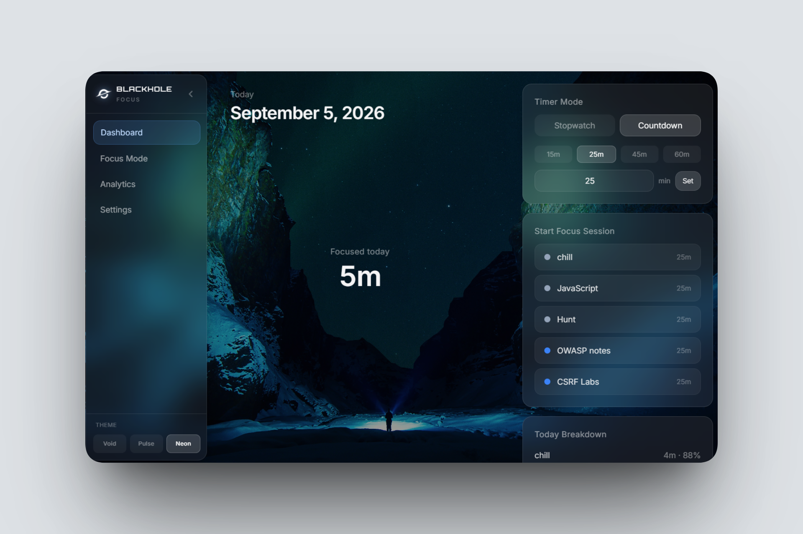
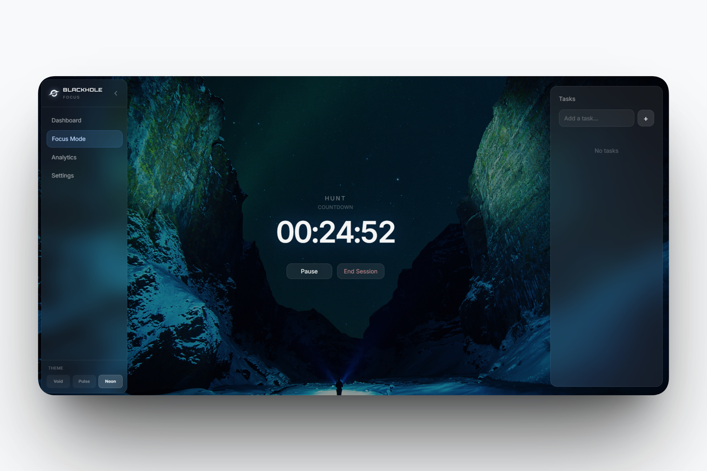
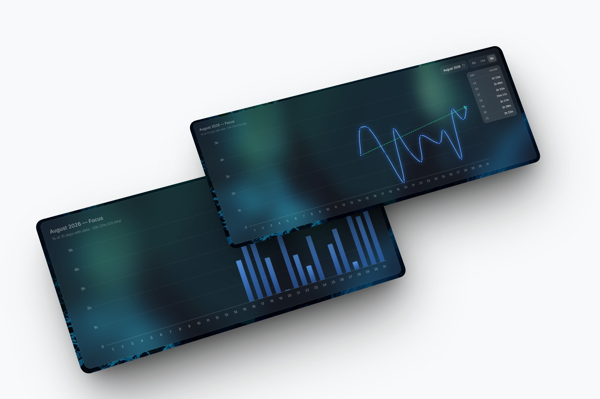
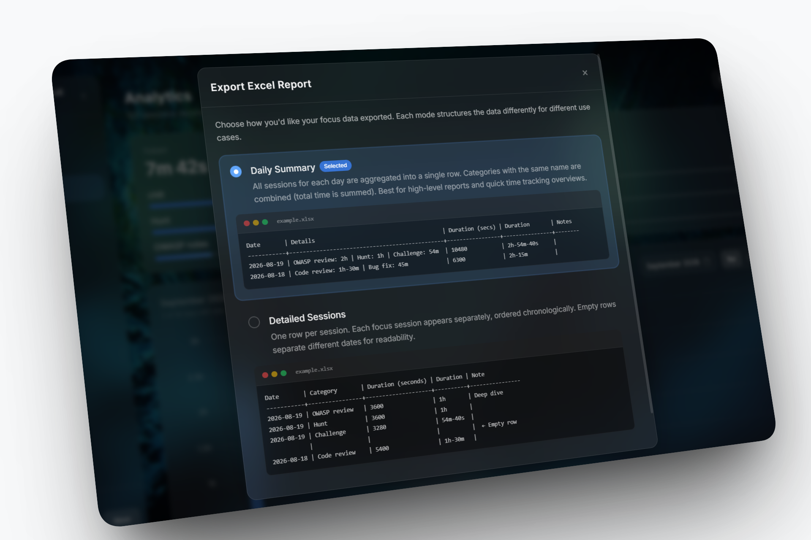
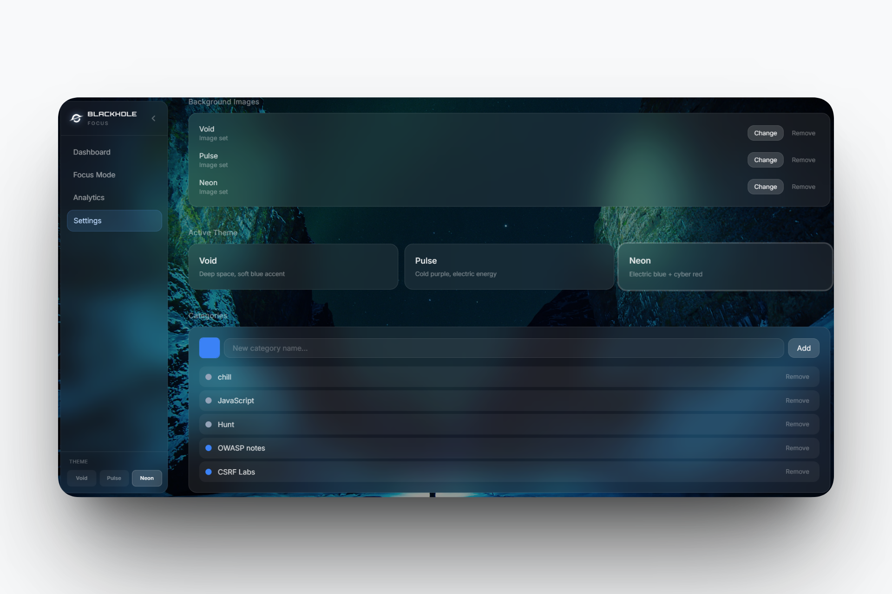

<p align="center">
  
</p>

<h1 align="center">BlackHole Focus <i>V1.4.0</i></h1>

<p align="center">
  Personal focus tracker for Windows<br/>
  Electron · React · TypeScript · Tailwind
</p>

<p align="center">
  
  
  
  
</p>

---

## What is this?

**BlackHole Focus** is a desktop focus app. You start timed work sessions by category, track how long you focused, manage a simple task list, switch visual themes, and export history to Excel.

All data stays on your machine. No account. No server.

**Important Note: Make sure you've a backup of data folder before install any update. You can find the data folder's path on settings.**

---

## Features

### Timer & sessions

- **Stopwatch** — counts up until you end the session  
- **Countdown** — presets (15 / 25 / 45 / 60 min) or custom minutes, drawn as an animated wavy timeline under the clock; beeps at zero  
- **Pomodoro** — focus/break cycles with fully configurable focus, short break, long break and “long break every N cycles”. The live session shows a **FOCUS · CYCLE n** / **BREAK · CYCLE n** badge, the animated wavy timeline, an emerald “Rest — not recorded” line and a **Skip Break** button; break time is never counted as focus  
- **Session-end alerts** — the classic *Bip-Bip* chime plus a Windows notification (also when the app sits in the tray); toggle in Settings → App  
- **Tasks** — add, complete, delete during Focus Mode  
- **Global hotkey** — `Ctrl+Alt+F` pauses / resumes the running session from anywhere  
- **Run in background** — closing the window keeps your session going from the system tray, with a notification when it moves there  
- **Session recovery + crash journal** — the active session is checkpointed every second, so if the app crashes or quits mid-session it restores paused on next launch and shows a recovery banner on the Dashboard  

### Organisation & insight

- **Categories** — add or remove categories in Settings with an arbitrary colour  
- **Themes** — Void, Pulse, Neon (optional background image per theme) + a **per-theme accent colour**: 8 presets, a custom picker, or Reset — the accent drives the nav highlight, charts, bars and the Focus timer glow, and very dark picks are lifted automatically so text stays readable  
- **Command palette** — `Ctrl+K` opens a quick launcher: jump to any view, start a focus session by category, toggle today's Break Time, or end the running session  
- **Collapsible sidebar** — slide it away with the collapse button; bring it back with the **Menu** button (your choice is remembered)  
- **Break Time (rest days)** — mark rest days (from the Analytics card, the command palette, or a right-click on any chart day). Break days are excluded from every statistic, chart and export and are always labelled “Break Time”  
- **Analytics** — sessions grouped by day, with date/range filters  
- **Range statistics** — Total, Mean / day, **Median / day**, **Trend (±/day)**, Std deviation, Variance, days with data and break days — plus a **▲/▼ % vs previous period** chip that compares the same-length period immediately before  
- **Drag-to-select range** — drag across the monthly chart to set the Range statistics *From* / *To* in one gesture  
- **Year in focus** — a GitHub-style heatmap of every day of the chart's year (accent intensity = focus time, emerald = break; right-click a cell to toggle Break Time)  
- **Focus rhythm** — 24-hour histogram showing *when* in the day you focus, with hover tooltips and a quiet empty state when the day has no sessions yet  
- **Smart break suggestion** — if no Break Time has been marked for 10+ days, Analytics suggests the weekday with your lightest focus load and offers a one-click “Mark … as break” (with a Dismiss)  
- **History, paginated** — 30 day-groups per page with **Newer / Older** paging, plus “jump to date” and range filters  
- **Inline session editing** — press **Edit** on any history row to change duration, category or note in place  
- **Excel export** — date, category, duration. Two modes: **Daily Summary** & **Detailed Sessions**; Break Time rows are zeroed and marked “Excluded from stats”  
- **Chart** — monthly focus chart with **Bar / Line / Sin** views; browse any recorded month (left = oldest)  
- **Daily goal** — set a target, see progress, or hit **Suggest** to use the median of your recent non-break days  

### Data, backup & quality of life

- **Local persistence** — flat files on disk via Electron; sessions are appended (NDJSON) and every write is atomic (temp file + rename), so a crash can't corrupt your history  
- **Backup & restore** — **Backup all data** writes one bundle JSON; **Import sessions** reads NDJSON/JSON bundles and dedupes by id  
- **Custom data folder** — move the data folder anywhere (e.g. a synced drive), open it in Explorer, or reset to the default location  
- **Corrupt-line repair** — any unreadable line in `sessions.ndjson` is preserved in `sessions.corrupt.ndjson` instead of being dropped silently  
- **Midnight split & merge** — a session that crosses local midnight is split into two days; overlapping same-category entries are merged on save  
- **Autostart** and **live black-hole wallpaper** toggles  

---

## What's new in 1.4.0

- **New typefaces** — Manrope for the UI and Space Grotesk for headings and the timer. Both are self-hosted variable fonts, so they render identically offline and in the installed app
- **Wavy timeline** — the countdown / Pomodoro progress ring is gone; an animated sine timeline under the clock now shows elapsed and remaining time (Stopwatch shows the same wave flowing, unfilled), with reduced-motion support
- **Accent colour actually applies everywhere** — nav highlight, Today bars, monthly chart, Focus timer glow and the rhythm chart; near-black accent picks are lifted to stay legible
- **Analytics fixes** — the Focus rhythm histogram rendered empty bars and the heatmap legend swatch was invisible; both now paint with the active accent
- **Roomier Dashboard** — slimmer side panel and tighter cards, so the timer block owns the centre of the window
- **Window floor** — the window can be resized and remembers its size, with a **1040 × 700** minimum so the rail, timer and side panel never collide. The Android/Capacitor build has been removed; the project is Windows-only
- **Fixes** — a Pomodoro session note no longer carries into the next cycle, and the Focus Mode task panel no longer collapses onto the timer

---

## Screenshots

**Dashboard** — start a Stopwatch or Countdown session


**Focus Mode** — live timer with pause / resume and tasks on the side


**Analytics** — monthly chart, range statistics, history & Excel export


**Excel Report** — detailed & summary report to excel file


**Settings** — themes, per-theme backgrounds, categories & data path



---

## Project layout

```
blackhole-focus/
├── build/                 # Windows icon (icon.ico) + notes
├── electron/
│   ├── main.js            # Window + tray + IPC + file storage, journal,
│   │                      # backup/import, midnight split & merge
│   └── preload.js         # contextBridge API (typings: src/vite-env.d.ts)
├── public/                # Static assets copied as-is (icon, theme extras)
├── src/
│   ├── assets/            # Bundled images (bh-logo.png, blackhole.jpg)
│   ├── components/        # Sidebar, Background, TitleBar, MonthChart,
│   │                      # WavyTimeline, SessionEditRow, Toast, DatePicker,
│   │                      # MonthPicker, ColorPicker, ExportModal,
│   │                      # CloseSessionModal
│   ├── lib/               # Helpers: date, stats, format, theme (palettes)
│   ├── pages/             # Dashboard, FocusMode, Analytics, Settings
│   ├── store/             # Zustand state: timer, Pomodoro, settings, journal
│   ├── db/                # Electron IPC for read/write (localStorage
│   │                      # fallback for the browser preview)
│   ├── App.tsx            # Shell: views, shortcuts, palette, tray/close wiring
│   ├── CommandPalette.tsx # Ctrl+K quick actions overlay
│   ├── main.tsx           # Entry point
│   ├── index.css          # Glass-morphism styles + theme definitions
│   └── vite-env.d.ts      # electronAPI typings
├── images/                # README screenshots + optional assets
├── vid/                   # blackhole.mp4 — live wallpaper (bundled at build)
├── index.html
├── package.json
├── vite.config.ts
├── tailwind.config.js
├── postcss.config.cjs
├── tsconfig.json
├── tsconfig.node.json
└── README.md
```

Created at runtime (not committed):

- `data/` — sessions, categories, tasks, rest days, settings (dev)  
- `dist/` — Vite output  
- `dist-electron/` — Windows build output  
- `node_modules/`  
- `harness.html` + `src/harness.tsx` — local test harness (ignored, see `.gitignore`)  

---

## Requirements

- Node.js **18+** (20 recommended)  
- npm  
- Windows 10/11 (for the packaged app)  

```bash
node -v
npm -v
```

---

## Install & run (development)

```bash
git clone https://github.com/sam0x001/BlackHoleFocus
cd BlackHoleFocus
npm install
npm run dev
```

This starts Vite and opens the **Electron** window.

> Use the Electron window, not only the browser at `localhost:5173`.  
> Saving data depends on Electron’s main process.

---

## Scripts

| Command | Description |
|---------|-------------|
| `npm run dev` | Develop (Vite + Electron) |
| `npm run build` | Production build + Windows installer / unpacked exe |
| `npm run preview` | Preview Vite build in the browser (no Electron storage) |

---

## Build (Windows)

1. Put a multi-size icon at:

```text
build/icon.ico
```

   (16, 32, 48, 256 sizes recommended)

2. Build:

```bash
npm run build
```

3. Outputs:

| Path | Use |
|------|-----|
| `dist-electron/*Setup*.exe` | Installer — share this with others |
| `dist-electron/win-unpacked/*.exe` | Unpacked app for local testing |

---

## Data location

| Mode | Path |
|------|------|
| Development | `./data/` in the project folder |
| Production | `%APPDATA%\BlackHoleFocus\data\` |

Files inside `data/`:

| File | Content |
|------|---------|
| `sessions.ndjson` | Focus sessions — append-only, one JSON object per line, newest first |
| `sessions.corrupt.ndjson` | Lines that could not be parsed (kept for manual recovery) |
| `sessions.json` | Legacy file — read once and migrated to `.ndjson` on first launch |
| `categories.json` | Categories |
| `tasks.json` | Tasks |
| `restDays.json` | Break Time (rest) days — excluded from stats/charts/export |
| `settings.json` | Theme, per-theme backgrounds & accent, timer mode, Pomodoro, sidebar, session alerts, active session |
| `active-session.json` | Crash-recovery journal, rewritten at most every 2 s while a session runs |
| `window-bounds.json` | Remembered window size / position |
| `custom-data-dir.txt` | Marker that the data folder was moved (kept in the app's own user-data dir) |

---

## How to use

1. **Dashboard** — pick Stopwatch, Countdown or Pomodoro, then start a category  
2. **Focus Mode** — timer, pause/resume/end, Pomodoro phase badge and **Skip Break**, tasks on the side  
3. **Analytics** — chart, range statistics, Break Time, history + Export Excel  
4. **Settings** — storage/backup, theme & accent colour, Pomodoro cycles, categories  

Drag the top bar to move the window. Use the collapse button on the sidebar (or the **Menu** button once hidden) to show / hide the sidebar.

The window is freely resizable up to your screen size and remembers its size and position between launches. The minimum is **1040 × 700** — the smallest size where the sidebar, timer and side panel still fit without overlapping.

### Keyboard shortcuts

| Keys | Action |
|------|--------|
| `Ctrl+K` | Open the command palette |
| `Ctrl+Alt+F` | Pause / resume the running session (works app-wide) |
| `Space` | Pause / resume (when the timer is running) |
| `Esc` | Close palette, modals, or collapse the sidebar |
| Right-click chart day | Toggle Break Time for that day |
| Drag across chart | Set the Range statistics From / To |

---

## Share with others

Send the **Setup** `.exe` from `dist-electron/`.  
They do not need Node.js or this repository.

Windows may show SmartScreen for unsigned apps → *More info* → *Run anyway*.

---

## Troubleshooting

| Problem | What to try |
|---------|-------------|
| Data not saving | Use Electron window (`npm run dev`), not browser-only |
| Icon missing on exe | Valid `build/icon.ico` (256*256), delete `dist-electron`, rebuild |
| Stuck on Loading | Reinstall deps: delete `node_modules`, run `npm install` |
| Setup has no data after install | Fully install; data goes under `%APPDATA%\BlackHoleFocus\data\` |
| App keeps running after closing | That's the tray — right-click the tray icon and choose **Quit** |

---

## Tech stack

- Electron  
- React 18 + TypeScript  
- Vite  
- Tailwind CSS  
- Zustand  
- ExcelJS  
- Fonts: **Manrope Variable** (UI) + **Space Grotesk Variable** (display) — self-hosted
  through Fontsource and bundled by Vite, so they load offline and inside the
  packaged Windows app (no CDN, no CSP allowlist)

---

## License

MIT
